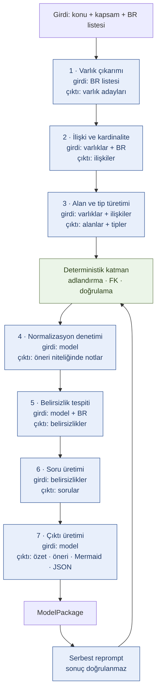
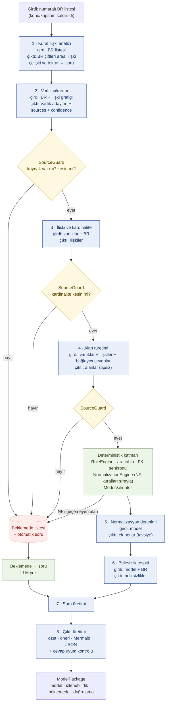
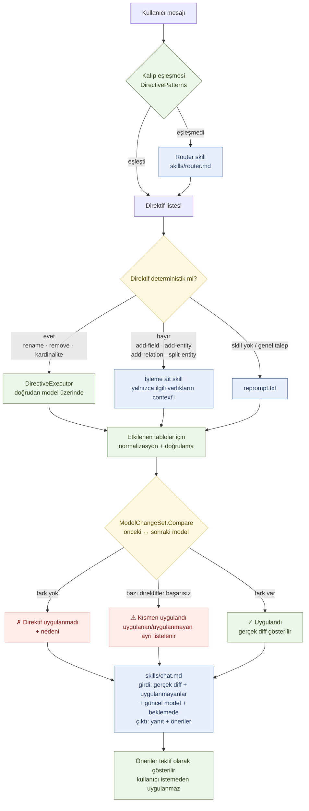

# Pipeline

Bu dosya koddaki **gerçek akışı** anlatır. Kaynak:
`DataModelGenerator.Core/Pipeline/ModelPipeline.cs` (`RunAsync`) ve
`PipelineStage.cs`. Uygulamadaki adım göstergesiyle (Madde 4) tutarlıdır:
gösterge kullanıcı adımlarını, buradaki diyagramlar bu adımların altında çalışan
pipeline adımlarını gösterir.

## Kullanıcı adımları ↔ pipeline adımları

Üstteki adım göstergesindeki 6 kullanıcı adımı ile 8 pipeline adımının ilişkisi:

| Adım göstergesi | Tetiklediği pipeline çağrısı | Çalışan pipeline adımları |
|---|---|---|
| 1. Bağlantı | — | — |
| 2. Girdi | — | — |
| 3. Üretim | `GenerateAsync` | 1 → 8 (hepsi) |
| 3. Üretim (öneri uygula) | `ApplySuggestionsAsync` → `RepromptAsync` | 5 → 8 |
| 4. Sorular | `ApplyAnswersAsync` | etkilenen adımdan → 8 |
| 4. Sorular (yeni soru) | `RequestQuestionsAsync` | 6 → 8 |
| 5. Sohbet | `SendChatAsync` | yalnızca etkilenen parça + 8 |
| 6. Dışa Aktar | — (dosya yazımı) | — |

## Eski akış (bu iyileştirmelerden önce)

7 adım, kural ilişki analizi yok, normalizasyon yalnızca LLM'e sorulan bir
denetimdi ve modele giren öğe için kaynak zorunluluğu yoktu.

**Eski akışın zayıf noktaları**
- Kurallar birbirinden bağımsız işleniyordu; çelişki ve tekrar fark edilmiyordu.
- Modelin ürettiği her şey modele giriyordu: kaynak zorunluluğu yoktu.
- Normalizasyon LLM'e soruluyordu; ihlal eden alan yine de modelde kalıyordu.
- Reprompt sonucunun gerçekten uygulanıp uygulanmadığı denetlenmiyordu.

## Yeni akış

8 adım. Başa kural ilişki analizi eklendi; her LLM çıktısı modele girmeden önce
kod tarafında süzülüyor; normalizasyon deterministik olarak işletiliyor.

### Adım tablosu

| # | Adım | LLM | Girdi | Çıktı |
|---|---|---|---|---|
| 1 | Kural ilişki analizi | ✔ `skills/analyze-br-relations.md` | BR listesi (2+ kural) | `RuleRelation[]`; `çelişir`/`tekrar` → beklemede + soru |
| 2 | Varlık çıkarımı | ✔ `extraction.txt` | BR + ilişki grafiği | varlık adayları (`sources`, `confidence`) |
| 3 | İlişki ve kardinalite | ✔ `relationships.txt` | varlıklar + BR | ilişkiler + kardinalite |
| 4 | Alan türetimi | ✔ `attributes.txt` | varlıklar + ilişkiler + bağlayıcı cevaplar | alanlar (tipsiz) |
| 5 | Normalizasyon denetimi | ✔ `normalization.txt` | model | tavsiye niteliğinde notlar |
| 6 | Belirsizlik tespiti | ✔ `gaps.txt` | model + BR | `Ambiguity[]` |
| 7 | Soru üretimi | ✔ `questions.txt` (+ beklemede → soru, LLM'siz) | belirsizlikler + beklemede listesi | `ClarifyingQuestion[]` |
| 8 | Çıktı üretimi | ✔ `summary.txt` | model + cevaplar | özet, öneriler, Mermaid, JSON, cevap uyumu |

Adım 7 yalnızca ilk üretimde ve kullanıcı "Yeni Sorular Üret" dediğinde çalışır;
cevap uygulandığında kendiliğinden tetiklenmez (sonsuz soru döngüsünü önler).

### Her adımdan sonra çalışan deterministik katman (LLM yok)

`ApplyDeterministicLayer` sırayla:

1. `RuleEngine.Normalize` — teknik adlandırma, PK/FK tamamlama.
2. `ModelMerger.CreateJunctionTables` — N-M ilişkiler için ara tablo.
3. `ModelMerger.SyncForeignKeys` + `RuleEngine.RelinkReferences`.
4. `NormalizationEngine.Apply` — `skills/NORMALIZATION_RULES.md` kurallarını
   sırayla işletir; geçemeyen alan **modelden çıkarılır** ve beklemede listesine alınır.
5. `ModelValidator.Validate`.

## Sohbet akışı (hedefli değişiklik)

Sohbetten gelen bir talep için tüm pipeline baştan çalışmaz.

Mesaj kural listesine `CHAT-xx` olarak eklenir; o turda modele giren her öğe bu
kimliği kaynak olarak taşır ve izlenebilirlik tablosunda görünür.

### Alanlar neden baştan yazılmaz

Model yanıtı çoğu zaman yalnızca **değişen** alanı içerir. Gelen listeyi varlığın
yeni tam hali saymak, daha önce eklenmiş alanların sessizce kaybolmasına yol
açıyordu — sohbetin kendi eklediği alanı bir sonraki turda bulamamasının nedeni
buydu. Artık alanlar `ModelMerger.MergeAttributes` ile toplanarak birleştirilir;
silme yalnızca modelin açıkça bildirdiği `removedFields` listesiyle yapılır ve
birincil anahtar bu listede olsa bile kaldırılmaz. Aynı ilke varlık ve
ilişkilerde zaten geçerliydi.

Router'a giden model özeti her alanı **hem görünen hem teknik adıyla** ve PK/FK
işaretleriyle verir; kullanıcı alana hangi adla atıfta bulunursa bulunsun
eşleşme sağlanır.

## Kısmi yeniden çalıştırma

Bir cevap uygulandığında pipeline baştan değil, belirsizliğin türüne göre
belirlenen adımdan itibaren çalışır (`PipelineStageMap.AffectedStage`):

| Belirsizlik türü | Yeniden başlanan adım |
|---|---|
| `EntityExistence` | 2 · Varlık çıkarımı |
| `Cardinality` | 3 · İlişki ve kardinalite |
| `PrimaryKey`, `ForeignKey`, `DataType`, `Requiredness` | 4 · Alan türetimi |
| `Naming`, diğer | 5 · Normalizasyon denetimi |

Adım 2 veya 3'ten başlanıyorsa kapsam temizlenir ve model bütün olarak
değerlendirilir; daha sonraki adımlardan başlanıyorsa yalnızca etkilenen
varlıklar LLM'e gönderilir.
